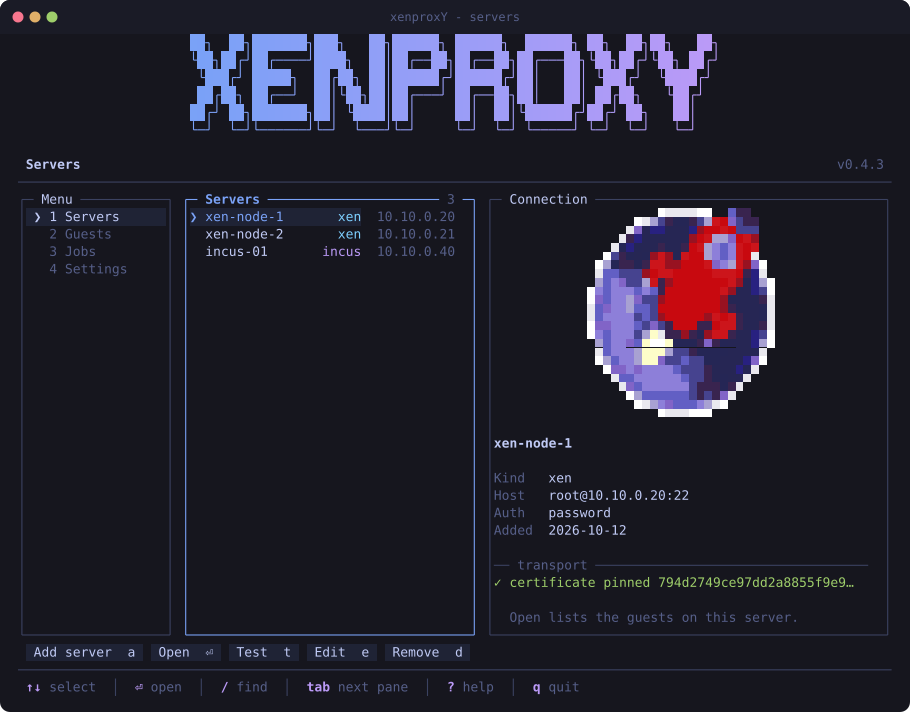

# xenproxY

Migrate XenServer / XCP-ng guests to Proxmox VE — from an interactive terminal
UI that runs on the Proxmox node itself.


## Install

```sh
curl -fsSL https://raw.githubusercontent.com/leanderkretschmer/xenproxY/main/install.sh | bash
```

Run it on the **Proxmox VE node** that will receive the guests. The installer
needs root, drops the package into `/opt/xenproxy` and puts a launcher at
`/usr/local/bin/xenproxY`. Nothing is installed on the Xen side.

Requirements: Python 3.9+ (Proxmox ships it), `curl`, and network access from
the Proxmox node to the Xen host on ports 22 and 443.

To pin a version: `XENPROXY_REF=v0.2.0 bash install.sh`.

## First run

```sh
xenproxY
```

With no server configured yet it opens the setup dialog. Enter host, user and
password. The SSH host key is shown for confirmation first, and only once you
accept it does anything leave the machine; then the connection is checked
**before** the entry is stored.


 The host
password is required even if you later switch SSH to a key, because the disk
export runs through the XAPI HTTPS endpoint.

Once saved the host shows up in the server list, where `t` re-checks the
connection and `⏎` opens its guests.



Configuration lives in `/etc/xenproxy/config.json`, mode `0600`, with the
accepted host keys next to it in `/etc/xenproxy/known_hosts`.

## What it does

Navigate the guests on the Xen host, inspect disks and NICs, then press `m` to
open the migration wizard:

| Step | Choice |
|---|---|
| **Mode** | `offline`, `snapshot` or `live` |
| **Target** | VMID, name, storage pool |
| **Network** | keep MAC/VLAN, new settings, defer, or no NIC |
| **Hardware** | cores, sockets, memory, firmware, machine type, CPU |
| **Options** | start afterwards, adapt guest, verify, start on boot |
| **Review** | summary plus warnings, `⏎` starts |


The last step restates the whole plan and calls out anything worth a second
look - a source that is about to be shut down, a VMID that is taken, a MAC
that would collide with the still-running source.


The Jobs screen shows throughput, per-step state and a live log; finished runs
are kept in `/var/lib/xenproxy/jobs`.


### Copy modes

| Mode | Downtime | Change on Xen | Consistency |
|---|---|---|---|
| `offline` | yes, for the copy | power state only | full |
| `snapshot` | none | temporary snapshot, removed afterwards | full, at snapshot time |
| `live` | none | **none** | crash-consistent |

`live` reads the volume while the guest runs, so the guest replays its journal
on first boot. Use it when the source must not be touched at all; use `offline`
when the data matters more than the downtime.

### How disks are copied

Disks are pulled as a raw stream from the XAPI endpoint `export_raw_vdi`
straight onto the freshly allocated Proxmox volume — one pass, no staging file,
no intermediate conversion. XAPI resolves VHD differencing chains itself, so
snapshots and chained base images come out whole.

With *verify* on (default), the checksum of the received stream is compared
against a read-back of the written volume.

### Guest adaptation

Under Xen a paravirtual NIC is called `eth0` because it has no PCI path. Under
KVM a virtio NIC becomes `ens18`, and a static `/etc/network/interfaces` stops
matching. When *adapt guest* is on, xenproxY mounts the migrated root volume
and pins `net.ifnames=0 biosdevname=0` in `/etc/default/grub` and in the
existing `grub.cfg` entries, keeping backups as `*.pre-xenproxy`. It also warns
when `/etc/fstab` names devices directly or the initramfs carries no virtio
modules.

Themes, defaults and the update check live under Settings - `tokyo-night`,
`dracula`, `nord`, `gruvbox`, `default` and `high-contrast`, each with
rounded, single, double or plain ASCII borders.


## Command line

Everything the TUI does is scriptable:

```sh
xenproxY servers                      # configured Xen hosts
xenproxY add --name xen1 --host 10.0.0.5   # shows the host key, then prompts
printf '%s\n' "$PW" | xenproxY add --name xen1 --host 10.0.0.5 \
    --host-key-fingerprint SHA256:jCTxF+T3ZM3IL50Cb3ouMuUBCn82v7 --password-stdin
xenproxY test --server xen1
xenproxY list                         # guests on the Xen host
xenproxY show leander-gameserver
xenproxY migrate leander-gameserver \
    --mode offline --storage local-zfs --vmid 210 \
    --net keep --bridge vmbr0 --vlan 1051
xenproxY migrate some-vm --dry-run    # print the plan, change nothing
xenproxY jobs
xenproxY update --check
```

## Updates

On start xenproxY asks GitHub for the newest release and offers to update when
one exists. `xenproxY update` does the same on demand; `--check` only reports.
Updating replaces `/opt/xenproxy` and leaves `/etc/xenproxy` alone.

## Security

xenproxY runs as root on the hypervisor and handles images authored
elsewhere, so a few things are deliberate:

- **The SSH host key is confirmed before anything is sent.** On first
  contact the host keys are fetched with `ssh-keyscan`, which authenticates
  nothing, and shown for comparison; only after you accept them are they
  written to `/etc/xenproxy/known_hosts` and only then does a password
  travel. Afterwards `StrictHostKeyChecking=yes` applies against that file,
  so a changed key stops the run instead of being absorbed. This is the
  first link in the chain: trusting whatever answers on first contact
  would hand a man in the middle both the host password and the
  certificate fingerprint below. Non-interactive use passes
  `--host-key-fingerprint SHA256:...`.
- **The XAPI certificate is pinned, and the channel fails closed.** When a
  server is added, its SHA-256 fingerprint is read from
  `/etc/xensource/xapi-ssl.pem` over that now-verified SSH session and
  stored alongside it. Every disk export verifies that fingerprint
  right after the TLS handshake and aborts *before* the credentials go
  out if it does not match. XCP-ng ships a self-signed certificate, so
  ordinary CA verification is not an option, and trusting it blindly
  would put the host password on the wire for anyone in the path. If
  neither a pin nor `verify_tls` is available the export refuses to run;
  `insecure_tls` on the server entry is the deliberate way to override
  that.
- **The migrated image is treated as untrusted.** It is mounted
  `nosuid,nodev,noexec`, and every file the guest adaptation touches is
  opened component by component with `O_NOFOLLOW` and `O_NONBLOCK`, then
  checked to be a regular file. A symlink inside the image - say
  `/etc/default/grub` pointing at `/etc/shadow` - would otherwise
  resolve against the *host* root and let a prepared image overwrite
  host files, and a FIFO in the same place would hang the migration
  until something wrote to it. Both are refused and reported by name.
- **Values coming from Xen are scrubbed of control characters** before
  they reach the terminal, so a guest named with an embedded escape
  sequence cannot repaint the screen or drive the emulator. Parsed
  fields are cleaned at the parser, and job log lines and notifications
  are cleaned again where they are rendered, because remote error text
  reaches the screen that way too.
- **The SSH askpass helper** lives in a private `0700` directory, is
  re-verified as a root-owned regular file before every reuse and is
  removed at exit - it is a small executable that prints a secret.
- **Values that end up in a `qm` property string are validated**, not
  just interpolated. A MAC read from Xen has to match a MAC exactly, a
  bridge name has to look like a bridge name, a VLAN tag has to be an
  integer in range - otherwise it is dropped or the migration stops.
  Otherwise a crafted VIF could smuggle extra options into `net0`.
- **A disk stream is capped at the size the VDI declares.** Anything
  beyond that is an error rather than something that keeps being written.
- Credentials live in `/etc/xenproxy/config.json`, mode `0600`, owned by
  root. There is deliberately no `--password` flag, because argv is
  readable from the process list: the password is prompted for, or read
  with `--password-stdin`, or taken from `XENPROXY_PASSWORD`.

## Notes

- The source guest is never deleted. After a successful migration it stays on
  the Xen host — halted in `offline` mode, untouched otherwise — so you keep a
  fallback.
- Guest and source share a MAC and IP. Do not run both on the same VLAN; the
  wizard warns when a plan would do that.
- `qemu-guest-agent` is not installed automatically. Install it inside the
  guest and set `agent: 1` afterwards.
- Only the first disk is adapted for KVM; extra data disks are copied as-is.

## Development

The images above are rendered straight from the real UI code, so they cannot
drift away from what the tool draws:

```sh
python3 tools/make_screenshots.py    # -> docs/screens/*.svg
```

`tools/ansi2svg.py` turns the renderer's ANSI output into SVG. Box-drawing
and shading characters are emitted as vectors rather than glyphs, so borders
connect and progress bars stay solid at any zoom level.

## Licence

MIT — see [LICENSE](LICENSE).
