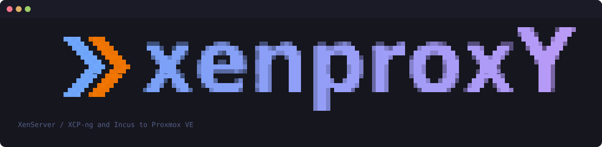
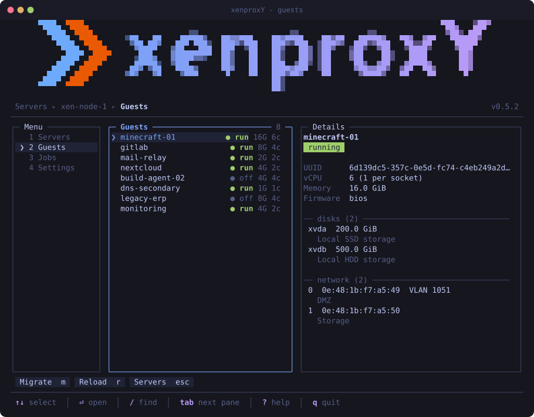
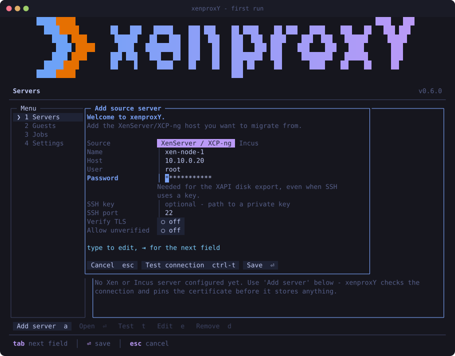
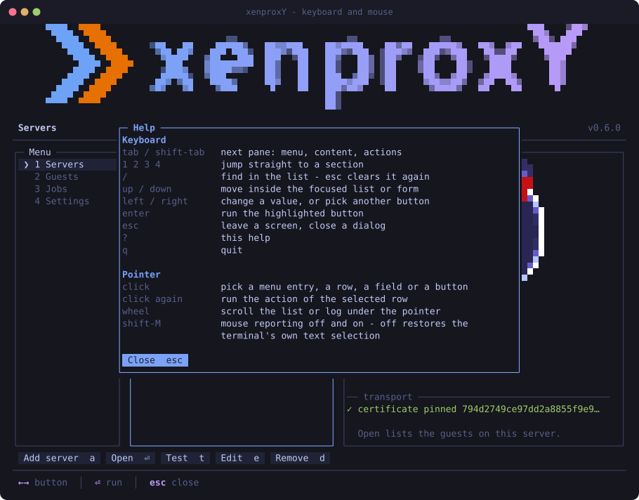
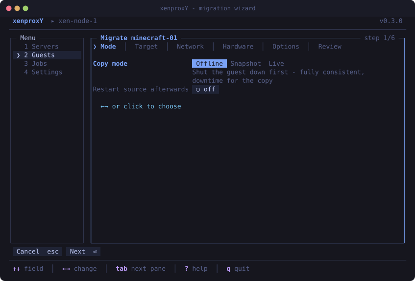
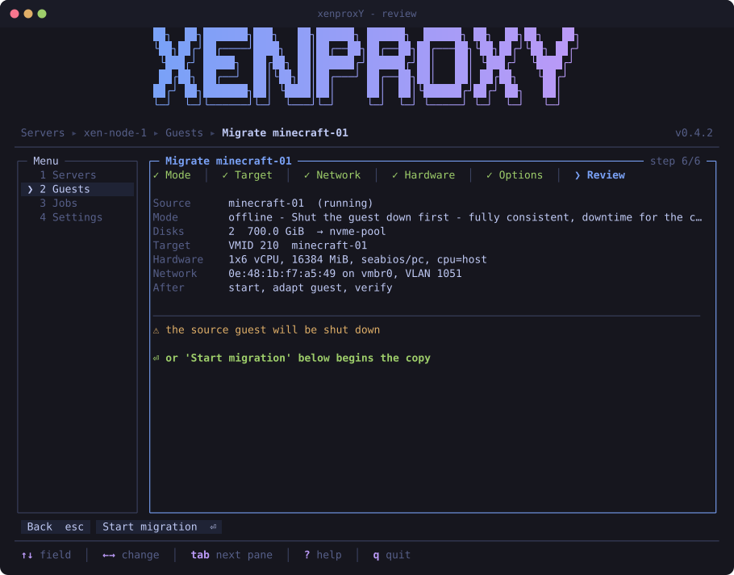
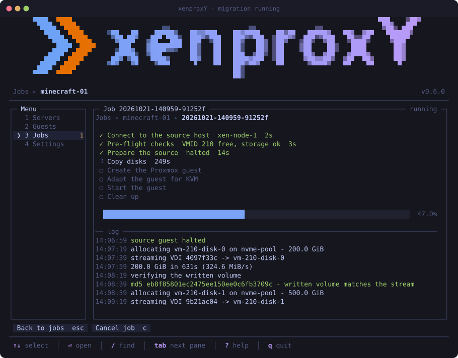
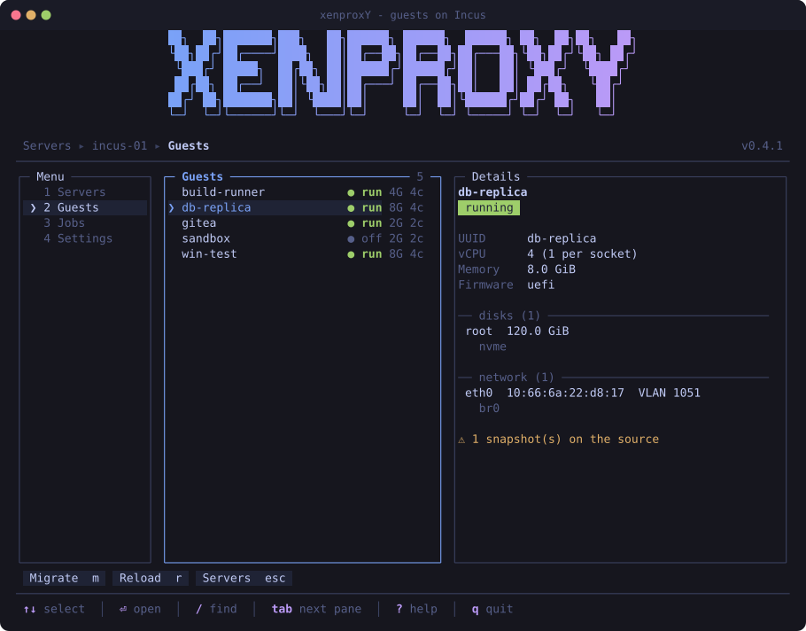
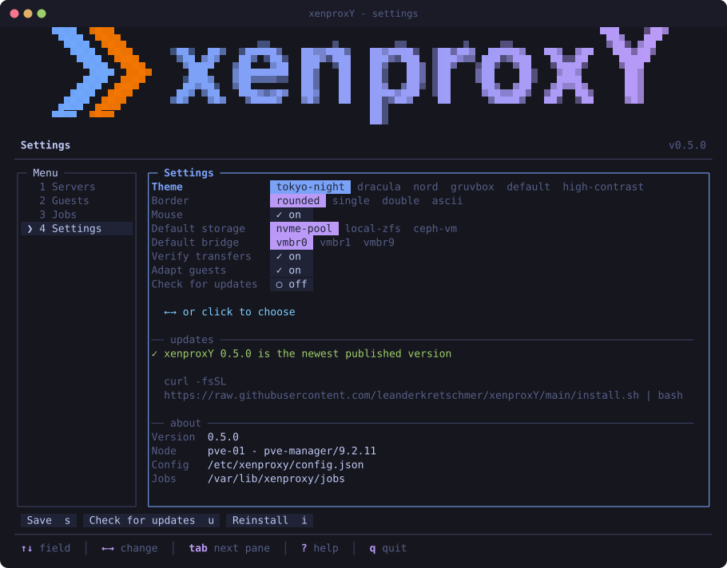

<p align="center">
  
</p>

<p align="center">
  
  &nbsp;&nbsp;&nbsp;
  
  &nbsp;&nbsp;&nbsp;
  
</p>

Move virtual machines off **XenServer / XCP-ng** and **Incus** onto **Proxmox
VE** — from a terminal interface that runs on the Proxmox node itself, or from
a browser. Disks are pulled as one raw stream straight onto the freshly
allocated volume: no staging file, no intermediate conversion, and the written
volume is read back and compared before the guest is declared migrated.



## Install

```sh
curl -fsSL https://raw.githubusercontent.com/leanderkretschmer/xenproxY/main/install.sh | bash
```

Run it on the **Proxmox VE node** that will receive the guests. The installer
needs root, drops the package into `/opt/xenproxy` and puts a launcher at
`/usr/local/bin/xenproxY`. Nothing is installed on the source side.

Requirements: Python 3.9+ (Proxmox ships it), `curl`, and network access from
the Proxmox node to the source host — port 22 for both kinds, plus 443 for
XenServer/XCP-ng. There are no Python dependencies at all.

To pin a version: `XENPROXY_REF=v0.3.0 bash install.sh`.

## Two ways in

```sh
xenproxY            # the terminal interface
xenproxY serve      # the same thing in a browser
```

Both read the same configuration, drive the same migration engine and write
to the same job history, so it does not matter which one you start a
migration from.

## The terminal interface

With no server configured yet it opens the setup dialog. Pick the kind of
source, then enter host, user and credentials. The SSH host key is shown for
confirmation first, and only once you accept it does anything leave the
machine; then the connection is checked **before** the entry is stored.



For a Xen host the password is required even if you later switch SSH to a key,
because the disk export runs through the XAPI HTTPS endpoint. An Incus host
needs no password at all when SSH uses a key: the disks come down the SSH
session itself.

### Finding your way around

Three rules cover the whole interface, and the footer always names the one
that applies right now:

| | |
|---|---|
| `tab` / `shift-tab` | move between the panes of a screen: **menu → content → actions** |
| `↑` `↓` `←` `→` | move inside whatever has focus |
| `⏎` | run the highlighted action — always drawn as a button |

Every screen carries its actions as a row of buttons above the footer, each
with its own shortcut on the face, so there is no key list to memorise. `1`-`4`
jump straight to a section, `/` searches the list in front of you, `esc` goes
back, and `?` opens this:



### Mouse

The pointer reaches everything the keyboard does. Click a menu entry, a list
row, a form field, a radio option, a switch or a button; click a row that is
already selected to run its action; roll the wheel to scroll the list or log
under the pointer. Breadcrumb steps in the migration wizard are clickable too,
so a value can be corrected without walking back through the pages.

While the terminal reports mouse events it stops doing its own text selection,
so `shift-M` turns reporting off and on at any time; the same switch sits in
Settings and is remembered.

### The migration wizard

Pick a guest and press `m`:

| Step | Choice |
|---|---|
| **Mode** | `offline`, `snapshot` or `live` |
| **Target** | VMID, name, storage pool |
| **Network** | keep MAC/VLAN, new settings, defer, or no NIC |
| **Hardware** | cores, sockets, memory, firmware, machine type, CPU |
| **Options** | start afterwards, adapt guest, verify, start on boot |
| **Review** | summary plus warnings, `⏎` starts |



The last step restates the whole plan and calls out anything worth a second
look — a source that is about to be shut down, a VMID that is taken, a MAC
that would collide with the still-running source.



The Jobs screen shows throughput, per-step state and a live log; finished runs
are kept in `/var/lib/xenproxy/jobs`.



## The web interface

```sh
xenproxY serve                      # http://127.0.0.1:8800
xenproxY serve --host 0.0.0.0       # reachable from the network
xenproxY token                      # print the token again
xenproxY token --new                # issue a new one
```

The URL it prints carries a token. That token is generated on first use and
kept at `/etc/xenproxy/web-token`, mode `0600`, beside the rest of the
configuration.

Three things hold the server shut, because it runs as root on a hypervisor and
can create and delete virtual machines:

- it **binds to the loopback address** unless told otherwise, so by default it
  is reachable only from the node itself — `ssh -L 8800:127.0.0.1:8800 root@node`
  is the intended way to use it from a laptop;
- every request carries the **token**, compared in constant time;
- and the API accepts that token **only in the `Authorization` header**, never
  from the cookie that lets the page itself load. A browser attaches a cookie
  to whatever another site provokes; it cannot attach a header, so there is
  nothing a hostile page can trigger.

There is no TLS. Binding to anything but loopback prints a warning and should
mean a reverse proxy in front.

## Sources

### XenServer / XCP-ng

Disks are pulled as a raw stream from the XAPI endpoint `export_raw_vdi`
straight onto the freshly allocated Proxmox volume. XAPI resolves VHD
differencing chains itself, so snapshots and chained base images come out
whole.

The inventory comes from `xe`, whose output is text; see **Security** below for
what that implies and how it is handled.

### Incus



Virtual machines are listed with their memory, CPU, firmware and NIC; the root
volume is pulled with `incus --quiet export <name> - --compression none`, whose
uncompressed tar stream is unpacked while it arrives. The member
`backup/virtual-machine.img` inside it is the raw disk, and its tar header
carries the authoritative byte count the target volume is sized from.

`--quiet` is not cosmetic: without it `incus` writes its progress bar to the
same stdout as the tarball.

Two things to know:

- **Containers are not listed.** They have no block device to hand to KVM.
- **Extra block devices are separate Incus volumes** and are not part of the
  instance export. The wizard says so when it sees any; copy them with
  `incus storage volume export`.

Incus runs its VMs on OVMF, so migrated guests are created with `bios: ovmf`
and get an EFI disk on the target.

## Copy modes

| Mode | Downtime | Change on the source | Consistency |
|---|---|---|---|
| `offline` | yes, for the copy | power state only | full |
| `snapshot` | none | temporary objects, removed afterwards | full, at snapshot time |
| `live` | none | **none** | crash-consistent |

`live` reads the volume while the guest runs, so the guest replays its journal
on first boot. Use it when the source must not be touched at all; use `offline`
when the data matters more than the downtime.

On Incus, `snapshot` mode needs a little room: `incus export` always exports an
instance as it stands, so the snapshot is copied into a throwaway instance,
that is what gets exported, and both are removed afterwards.

With *verify* on (default), the checksum of the received stream is compared
against a read-back of the written volume, whichever source it came from.

## Guest adaptation

Two things routinely break a guest that has just changed hypervisor, and both
are handled when *adapt guest* is on:

- **The NIC is renamed.** Under Xen a paravirtual NIC is called `eth0` because
  it has no PCI path; under KVM a virtio NIC becomes `ens18`, and a static
  `/etc/network/interfaces` stops matching. xenproxY mounts the migrated root
  volume and pins `net.ifnames=0 biosdevname=0` in `/etc/default/grub` and in
  the existing `grub.cfg` entries, keeping backups as `*.pre-xenproxy`.
- **A UEFI guest loses its firmware boot entry.** That entry lives in the
  source hypervisor's NVRAM and names the guest's loader; the target gets an
  empty one and falls back to `\EFI\BOOT\BOOTX64.EFI`. When the ESP has no
  such file, the first loader found under `EFI/` is copied into that path (and
  `grubx64.efi` alongside it when the loader is shim), so the guest starts
  instead of looking for a PXE server.

It also warns when `/etc/fstab` names devices directly or the initramfs
carries no virtio modules.

## Looks

A panel with room to spare carries the mark of whatever it is about — the
source server's own, or Proxmox where nothing is configured yet.
They are the real logos, sampled into terminal cells: U+2580 splits a cell
into an upper and a lower half, so two stacked pixels fit in one and come out
square. Colours are the logo's own, with anything too dark to see on a dark
terminal lifted until it is.

Themes, defaults, the mouse switch, the banner and the update check live under
Settings — `tokyo-night`, `dracula`, `nord`, `gruvbox`, `default` and
`high-contrast`, each with rounded, single, double or plain ASCII borders.



## Speed

The interface redraws many times a second, so nothing in a render path is
allowed to be expensive. Two things were: `pveversion` takes about 1.4 seconds
to print one line and `pvesm status` about 1.3, and both were being run on
every single frame of the Settings screen. A frame went from **1430 ms to
under 3 ms** once they were answered from a cache.

Everything else follows the same rule:

- the node name and its package version are read once — neither can change
  under a running process;
- storage free space is re-read every twenty seconds, and immediately after a
  disk is allocated;
- an inventory is kept per server, so going back to one you have already
  opened costs nothing and the source host is asked again only when the answer
  has gone stale;
- a guest's details are fetched a quarter of a second after the selection
  stops moving, so running down a list of fifty does not fire fifty round
  trips;
- colour escapes, character widths and the rendered marks are memoised, and
  the loop stops repainting on a timer when nothing is animating.

## Security

xenproxY runs as root on the hypervisor and handles images authored
elsewhere, so a few things are deliberate:

- **The SSH host key is confirmed before anything is sent.** On first
  contact the host keys are fetched with `ssh-keyscan`, which authenticates
  nothing, and shown for comparison; only after you accept them are they
  written to `/etc/xenproxy/known_hosts` and only then does a password
  travel. Afterwards `StrictHostKeyChecking=yes` applies against that file,
  so a changed key stops the run instead of being absorbed. Non-interactive
  use passes `--host-key-fingerprint SHA256:...`.
- **The XAPI certificate is pinned, and the channel fails closed.** When a
  Xen server is added, its SHA-256 fingerprint is read from
  `/etc/xensource/xapi-ssl.pem` over that now-verified SSH session and
  stored alongside it. Every disk export verifies that fingerprint right
  after the TLS handshake and aborts *before* the credentials go out if it
  does not match. XCP-ng ships a self-signed certificate, so ordinary CA
  verification is not an option, and trusting it blindly would put the host
  password on the wire for anyone in the path. If neither a pin nor
  `verify_tls` is available the export refuses to run; `insecure_tls` on the
  server entry is the deliberate way to override that. An Incus source needs
  none of this: its disks never leave the authenticated SSH session.
- **The web server's token is header-only for the API.** The cookie exists
  so the page can load and is useless for anything else.
- **Remote output is never trusted to be well formed.** `xe` prints a text
  format, so a guest name carrying a newline could otherwise forge whole
  records: records are only opened at a syntactically valid UUID, the
  listing is cross-checked against `xe ... --minimal`, and a repeated key
  or UUID stops the run rather than being silently resolved. Incus answers
  in JSON, where the structure is decided by the encoder, and instance
  names are matched against the hostname grammar before they are used.
- **The migrated image is treated as untrusted.** It is mounted
  `nosuid,nodev,noexec`, and every file the guest adaptation touches is
  opened component by component with `O_NOFOLLOW` and `O_NONBLOCK`, then
  checked to be a regular file. A symlink inside the image — say
  `/etc/default/grub` pointing at `/etc/shadow` — would otherwise resolve
  against the *host* root and let a prepared image overwrite host files, and
  a FIFO in the same place would hang the migration until something wrote to
  it. Both are refused and reported by name.
- **Values coming from the source are scrubbed of control characters**
  before they reach the terminal, so a guest named with an embedded escape
  sequence cannot repaint the screen or drive the emulator.
- **The SSH askpass helper** lives in a private `0700` directory, is
  re-verified as a root-owned regular file before every reuse and is
  removed at exit — it is a small executable that prints a secret.
- **Values that end up in a `qm` property string are validated**, not just
  interpolated. A MAC has to match a MAC exactly, a bridge name has to look
  like a bridge name, a VLAN tag has to be an integer in range — otherwise
  it is dropped or the migration stops.
- **A disk stream is capped at the size it declared.** Anything beyond that
  is an error rather than something that keeps being written, and a tar
  member claiming an implausible length is refused before a volume is
  allocated for it.
- Credentials live in `/etc/xenproxy/config.json`, mode `0600`, owned by
  root. There is deliberately no `--password` flag, because argv is readable
  from the process list: the password is prompted for, or read with
  `--password-stdin`, or taken from `XENPROXY_PASSWORD`.

## Command line

Everything both interfaces do is scriptable:

```sh
xenproxY servers                           # configured source hosts
xenproxY add --name xen1 --host 10.0.0.5   # shows the host key, then prompts
printf '%s\n' "$PW" | xenproxY add --name xen1 --host 10.0.0.5 \
    --host-key-fingerprint SHA256:jCTxF+T3ZM3IL50Cb3ouMuUBCn82v7 --password-stdin
xenproxY add --kind incus --name incus1 --host 10.0.0.40 \
    --key /etc/xenproxy/keys/incus1_ed25519 --accept-host-key --password-stdin </dev/null
xenproxY test --server incus1
xenproxY list --server incus1              # guests on that host
xenproxY show db-replica --server incus1
xenproxY migrate db-replica --server incus1 \
    --mode offline --storage local-zfs --vmid 210 \
    --net keep --bridge vmbr0 --vlan 1051
xenproxY migrate some-vm --dry-run         # print the plan, change nothing
xenproxY jobs
xenproxY serve --port 8800
xenproxY update --check
```

## Updates

On start xenproxY asks GitHub for the newest published version and offers to
update when one exists; that check stays quiet otherwise, so a node without
internet is not nagged at every launch.

**Check for updates** in Settings always says what it found — a newer version,
that you are on the newest one, that nothing is published yet, or why GitHub
could not be asked (an unauthenticated API allows 60 requests an hour per
address, which a node behind a busy NAT does run into).

**Reinstall** re-runs the installer against the current `main` branch:

```sh
curl -fsSL https://raw.githubusercontent.com/leanderkretschmer/xenproxY/main/install.sh | bash
xenproxY update --check          # report only
xenproxY update --force --yes    # reinstall from main without asking
```

Either way `/opt/xenproxy` is replaced and `/etc/xenproxy` is left alone, so
servers, host keys, the web token and settings survive.

## Development

The images above are rendered straight from the real UI code, so they cannot
drift away from what the tool draws:

```sh
python3 tools/make_screenshots.py            # -> docs/screens/*.svg
python3 tools/img2art.py docs/logos/proxmox.webp proxmox
python3 tools/figlet2art.py tools/ANSI-Shadow.flf xenproxY wordmark
```

`tools/ansi2svg.py` turns the renderer's ANSI output into SVG; box-drawing and
block characters are emitted as geometry rather than glyphs, so borders connect
and the marks have no seams. `tools/img2art.py` samples a logo into the colour
cell format under `xenproxy/art/`, and `tools/figlet2art.py` renders the
wordmark from a FIGlet font — both at build time, so the runtime needs neither
an image library nor a font file.

## Licence

MIT — see [LICENSE](LICENSE).
